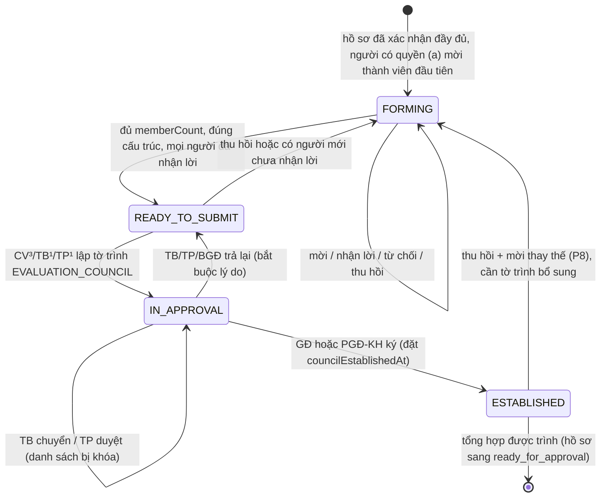
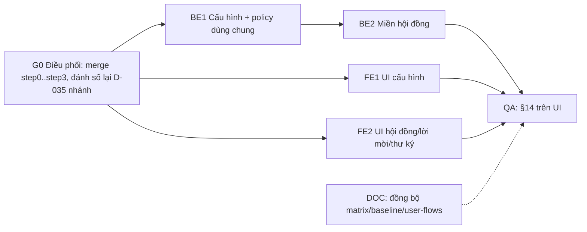

# Hội đồng thẩm định (hội đồng đánh giá hồ sơ đề xuất)

Nguồn quyết định: `_bmad-output/.decision-log.md` D-033 (vòng đời 9 bước), **D-035 "Cấu hình thành lập hội đồng do Admin quản lý"**, **D-036 "Phòng KHQS lập và trình; Ban giám đốc ký"**. Khi mâu thuẫn, `docs/permission-matrix.vi.md` §7 thắng, **trừ** điểm D-035 thay thế rõ ràng (người lập hội đồng mặc định TP/TB, không còn cố định TP/TB/CV).

"Hội đồng thẩm định" trong tài liệu này = hội đồng đánh giá ở bước 4 "Thẩm định, hội đồng" (D-033) của một hồ sơ đề xuất, trong một vòng nộp (một `reviewedSubmissionEventId`).

## 0. Tiền đề bắt buộc (đọc trước khi code)

1. **Baseline code là đỉnh nhánh `claude/step3-project-6-11-6-12-57d947`** (worktree `/Users/Super/DocManS/.claude/worktrees/step3-project-6-11-6-12-57d947`), không phải `HEAD` của `chore/rename-research-management-roles` (436bcb4). Chuỗi nhánh step0 → step1 (Story 5.9) → step2 (5.10) → step2b (5.11 + hội đồng do BGĐ ký) → step3 (6.11/6.12) chưa merge. Người điều phối phải merge chuỗi này vào nhánh làm việc **trước** khi phát các gói dev bên dưới. Mọi tên file/hàm trong spec này tham chiếu code trên đỉnh step3.
2. **Trùng mã quyết định.** Các nhánh step1/step2b có một mục "D-035 — Who sets REJECTED / CANCELLED on a tờ trình" (gồm quy tắc tờ trình do TP lập: TB chuyển thẳng `LEADERSHIP`). Cây làm việc hiện tại có D-035 khác (cấu hình Admin) và D-036. Khi merge, người điều phối đánh số lại mục của nhánh (đề xuất **D-037**). Spec này luôn gọi quyết định kèm tiêu đề.
3. Migration của nhánh đã tới `20261027000000_project_funding_liquidation`. Spec này **không thêm migration** (xem §4). Nếu một gói buộc phải thêm, timestamp phải lớn hơn `20261027000000`.
4. Seed hiện có thay đổi chưa commit ở `apps/api/prisma/seed.mjs`; không gói nào trong spec này được sửa file đó.

## 1. Phạm vi

**Trong phạm vi**

- Cấu hình thành lập hội đồng theo loại (`EVALUATION | ACCEPTANCE | IRB`) cho QT: role được phép thành lập/mời, số lượng thành viên. Chỉ `EVALUATION` được áp dụng trong lần này; `ACCEPTANCE`, `IRB` lưu được, hiển thị "Chưa áp dụng".
- Hội đồng đánh giá cho hồ sơ đề xuất: vị trí Chủ tịch, Phản biện, Ủy viên, Thư ký; mời, nhận lời/từ chối, thu hồi; conflict check; khóa danh sách khi đang trình.
- Tờ trình `EVALUATION_COUNCIL`: lập (CV³/TB¹/TP¹) → TB rà soát → TP duyệt → GĐ hoặc PGĐ-KH ký/trả lại (dùng lõi Story 5.9 đã có).
- Thành viên chỉ đọc hồ sơ sau khi BGĐ ký; mọi thành viên trừ thư ký chấm phiếu; thư ký soạn dự thảo tổng hợp/biên bản, không chấm.
- Cổng readiness của tổng hợp (Story 5.5/10.7) chuyển sang dựa trên hội đồng đã thành lập.

**Ngoài phạm vi (backlog)**

- Hội đồng nghiệm thu (`ACCEPTANCE_COUNCIL`) và IRB (`IRB_COUNCIL`, `IRB_CERTIFICATE`): lưu trữ thành viên, luồng, UI. Chỉ dùng chung cấu hình (§4.2), hàm policy (§7.1) và các `kind` tờ trình đã có.
- Hồ sơ đạo đức (Story 10.3, 10.4), liên kết văn bản Epic 9, lịch họp/chương trình/điểm danh (phần còn lại của 10.1/10.2).
- Tệp biên bản đính kèm (upload file `council_minutes`), email thông báo, hộp thư tờ trình (Story 11.6).
- Đồng bộ `docs/permission-matrix*.md`, `docs/authorization-core-business-baseline.md`, `docs/user-flows.md` theo D-035: làm ở gói DOC (§16), không làm trong gói code.

## 2. Đã có trên baseline — không đặc tả lại, chỉ sửa theo §8

| Thành phần | File (đỉnh step3) |
| --- | --- |
| Bảng tờ trình `approval_submissions`, `approval_steps`; `openApprovalSubmission`, `advanceApprovalSubmission`, `returnApprovalSubmission`, `assertReadyForLeadership`, `closeApprovalSubmission`, `canSignApproval` | `apps/api/prisma/migrations/20261025000000_approval_routing/`, `apps/api/src/proposals-shared/approval-routing.ts`, `apps/api/src/approvals/*` |
| Cột lời mời `invitation_status`, `responded_at`, `decline_reason`, `council_established_at` trên `proposal_review_assignments` | `apps/api/prisma/migrations/20261026000000_review_invitation_council/` |
| `grantsReviewAccess` (chỉ `accepted` + đã thành lập mới đọc hồ sơ), `INVITATION_STATUS_LABELS` | `apps/api/src/proposals-shared/proposal-review-access.ts` |
| `respondToInvitation`, ứng viên loại QT/không có lý lịch/chính mình, `assertNoPendingCouncil` | `apps/api/src/proposal-evaluations/proposal-review-assignments.service.ts` |
| `ProposalEvaluationCouncilService` (`getCouncil`, `submitCouncil`, `decideCouncil`, `councilRosterBlockers`) | `apps/api/src/proposal-evaluations/proposal-evaluation-council.service.ts` |
| `assertProposalManagementWriteScope` (TP¹/TB¹/CV³) | `apps/api/src/proposal-evaluations/proposal-evaluation-support.ts` |
| Route `POST :id/review-assignments/:assignmentId/respond`, `GET :id/evaluation-council`, `POST :id/evaluation-council/submit`, `POST :id/evaluation-council/decide` | `apps/api/src/proposal-evaluations/proposal-evaluations.controller.ts` |
| UI: `ProposalCouncilPanel`, `RoutingStatus`, lời mời trong `ReviewerQueuePanel` | `apps/web/src/components/research-proposals/proposal-council-panel.tsx`, `apps/web/src/components/approvals/routing-status.tsx`, `apps/web/src/components/research-proposals/reviewer-queue-panel.tsx` |
| Test PostgreSQL thật cho routing/hội đồng | `tests/approval-routing-db.test.mjs`, `tests/helpers/disposable-database.mjs` |

## 3. Quyết định thiết kế và lý do

1. **Không thêm model `Council`/`CouncilMember`. Thành viên hội đồng đánh giá là các hàng `ProposalReviewAssignment` của vòng hiện tại.** Lý do (theo code thật): conflict resolver (`resolveActorConflict`, `ProposalReviewAccessService.resolveConflictForProposal`), cổng đọc hồ sơ/tệp (`canReadProposal` + `grantsReviewAccess`), hàng đợi `/my-reviews`, phiếu `ProposalReview` (FK `assignmentId`), lời mời, thu hồi giữ lịch sử, audit và index duy nhất `proposal_review_assignments_active_reviewer_key (proposal_id, reviewer_user_id) WHERE status='assigned'` đều khóa theo bảng này. Một bảng thành viên mới sẽ phải nhân đôi tất cả hoặc đồng bộ hai nguồn. Danh tính hội đồng = `(proposalId, reviewedSubmissionEventId)`, đúng "evaluation context key" của `docs/authorization-core-business-baseline.md#evaluation-position-compatibility-and-multiplicity`. Thành viên hội đồng nghiệm thu (gắn đề tài) và IRB (gắn hồ sơ đạo đức) sẽ do story backlog tương ứng chọn lưu trữ; phần dùng chung là cấu hình, hàm policy và `kind` tờ trình.
2. **Cấu hình lưu trong `SystemParameter`** (đã có, đã admin-only, có audit), khóa `council_formation.EVALUATION|ACCEPTANCE|IRB`, giá trị JSON đã validate. Không cần migration; thiếu khóa thì dùng mặc định trong code.
3. **Ba quyền tách riêng** (code hiện gộp chung trong `assertProposalManagementWriteScope`):
   - (a) Thành lập hội đồng, mời/thu hồi mọi vị trí (kể cả phản biện): theo cấu hình D-035 (`canFormCouncil`, §7.1).
   - (b) Lập tờ trình `EVALUATION_COUNCIL`: CV³/TB¹/TP¹ theo D-036 và §7.1 matrix "Lập tờ trình"; giữ `assertProposalManagementWriteScope` + `openApprovalSubmission`.
   - (c) Rà soát/duyệt/ký: TB/TP/GĐ/PGĐ-KH theo lõi 5.9.
4. **Tờ trình gắn theo vòng**: `ApprovalKey = { kind: "EVALUATION_COUNCIL", subjectType: "proposal", subjectId: proposalId, subjectRef: reviewedSubmissionEventId }` (baseline đang dùng `subjectRef: ""`). Nộp lại hồ sơ sinh vòng mới, hội đồng mới, tờ trình mới.
5. **Trạng thái hội đồng là trạng thái suy ra**, không lưu cột riêng (§6), để không có hai nguồn sự thật với `approval_submissions` và `council_established_at`.
6. **Thư ký soạn bản nháp `ProposalEvaluationSummary`** (đã có) làm dự thảo tổng hợp/biên bản; TP¹/TB¹/CV³ chốt và trình. Không thêm bảng biên bản; tệp biên bản để backlog.
7. **Thông báo MVP là trong ứng dụng** (hàng đợi và panel). Chưa có hạ tầng thông báo; `MailService` ném `MAIL_NOT_CONFIGURED` khi thiếu SMTP. Email để Epic 11.

### 3.1 Đề xuất cần chủ sản phẩm xác nhận (mặc định trong spec, dev làm theo cho tới khi có quyết định khác)

| Mã | Đề xuất mặc định | Lý do |
| --- | --- | --- |
| P1 | `memberCount` là **số cố định**, tính **tổng số người kể cả thư ký**. Cấu trúc cố định trong code: đúng 1 Chủ tịch, đúng 2 Phản biện, đúng 1 Thư ký, Ủy viên = `memberCount − 4` (≥ 1). Mặc định `EVALUATION = 7` (1 CT + 2 PB + 3 UV + 1 TK). Phạm vi hợp lệ `EVALUATION`: 5–15. `ACCEPTANCE`, `IRB`: lưu 3–15, mặc định 7 và 5, chưa áp dụng. | Giữ quy tắc hiện tại "đúng 2 phản biện" và tương đương "≥ 3 thành viên chấm ngoài phản biện" (CT + 3 UV = 4 ≥ 3). Một nguồn sự thật thay cho cổng cứng 2+3. |
| P2 | **Chặn lập tờ trình và chặn ký** khi số thành viên còn hiệu lực ≠ `memberCount`, sai cấu trúc, còn người chưa nhận lời hoặc đã từ chối chưa thu hồi. Không chặn việc mời từng người (được mời dần tới đủ số; mời vượt số/vị trí bị từ chối). | D-036 đã chặn khi chưa nhận lời; mở rộng cho số lượng. |
| P3 | Admin chỉ được tích trong 4 role Phòng KHQS: TP, PP, TB, CV. Không tích được QT (D-014), BGĐ (người ký, tách quyền), NCV, NNB (không có phạm vi quản lý). Phạm vi: TP/PP/TB theo đơn vị chủ trì hồ sơ¹; CV chỉ hồ sơ đang phụ trách³. Phải tích ít nhất 1 role. | D-035 nói "các role khác… Admin tích thêm nếu cần" nhưng không định nghĩa phạm vi cho role ngoài KHQS. |
| P4 | Mời **Phản biện** cũng theo cấu hình (a). Với mặc định, CV **mất** quyền mời phản biện cho tới khi QT tích CV. | Phản biện là vị trí trong hội đồng; matrix §7.4 coi phân công phản biện là việc CV tự làm, mâu thuẫn với D-035. |
| P5 | Thay đổi cấu hình **không** ảnh hưởng hội đồng đã thành lập; hội đồng chưa trình áp số lượng mới ngay; hội đồng đang trình bị kiểm tra lại khi ký (có thể bị chặn ký, phải trả lại). | Không cần lưu snapshot. |
| P6 | Không mời người giữ bước bắt buộc nếu mời họ làm luồng tắc: từ chối `ROUTING_ACTOR_UNAVAILABLE` khi ứng viên là TB đang hoạt động duy nhất không xung đột, là TP cuối cùng có phạm vi đơn vị chủ trì không xung đột, hoặc là người ký cuối cùng (GĐ/PGĐ-KH đang hoạt động) không xung đột. Người đã thao tác (chuyển/duyệt/ký) trên tờ trình hội đồng của vòng này không được mời (`ROUTING_ACTOR_CONFLICT`). | Matrix cho mời GĐ/PGĐ/TP/TB; brief yêu cầu conflict với người rà soát/duyệt/ký. Quy tắc này giữ cả hai mà không gây bế tắc. |
| P7 | Thư ký (đã nhận lời, hội đồng đã thành lập) xem: gói hồ sơ, tiến độ (số phiếu đã/chưa gửi, điểm trung bình), các phiếu đã gửi **ẩn danh** "Phiếu 1..N" (điểm từng tiêu chí, kết luận, nhận xét), **không** có tên/vai trò người chấm. Thư ký lưu nháp tổng hợp; không chốt, không trình. | Story 10.2 cấm lộ danh tính/điểm thô cho thư ký nhưng thư ký phải soạn tổng hợp. Nhận xét tự do vẫn có thể lộ danh tính gián tiếp. |
| P8 | Sau khi thành lập, vẫn được thu hồi/mời thay thế (khi hồ sơ còn `under_review` và tổng hợp chưa chốt). Người mới cần **tờ trình bổ sung** `EVALUATION_COUNCIL` cùng vòng; thành viên cũ giữ quyền. | Hành vi suy ra từ code 5.10; ghi rõ thành quy tắc. |
| P9 | Từ chối lời mời giữ nguyên hàng (`invitationStatus=declined`, `status=assigned`) cho tới khi người quản lý thu hồi; hàng từ chối vẫn chiếm vị trí và vẫn tính xung đột tới khi thu hồi. | Giữ hành vi baseline 5.11, ít thay đổi. |

## 4. Mô hình dữ liệu

### 4.1 Không có bảng/migration mới

| Thay đổi | Cách làm |
| --- | --- |
| Vị trí hội đồng | `proposal_review_assignments.assignment_role` (TEXT, không có CHECK) nhận thêm `council_chair`, `council_secretary`. Giữ `reviewer` (Phản biện) và `committee_member` (Ủy viên) để không phải migrate dữ liệu cũ. |
| Danh tính hội đồng | `(proposal_id, reviewed_submission_event_id)`. |
| Đã thành lập | `council_established_at` (đã có) khác null trên mọi hàng còn hiệu lực của vòng. |
| Tờ trình | `approval_submissions` với `kind='EVALUATION_COUNCIL'`, `subject_type='proposal'`, `subject_id=proposalId`, `subject_ref=reviewedSubmissionEventId`. |
| Một vị trí/người/vòng | Do kiểm tra trong mutation có khóa hồ sơ (`runProposalMutation`) bảo đảm (xét hàng `assigned` và `completed` của vòng). Index có sẵn `(proposal_id, reviewer_user_id) WHERE status='assigned'` chỉ là lớp chặn phụ theo **hồ sơ** (không theo vòng, không gồm `completed`). Hệ quả: hàng `assigned` chưa thu hồi của vòng cũ chặn mời lại đúng người đó ở vòng mới; mutation phải báo lỗi rõ ("Còn phân công vòng trước chưa thu hồi") thay vì lỗi P2002 thô. |
| Cấu hình | `system_parameters` (§4.2). |

Không cần chạy migration. Dữ liệu cũ: hàng `reviewer`/`committee_member` của vòng cũ giữ nguyên; vòng cũ không có chủ tịch/thư ký nên hiển thị "Hội đồng theo quy tắc cũ" và không bị cổng mới chặn nếu `council_established_at` đã có (backfill 20261026 đặt sẵn).

### 4.2 Cấu hình `SystemParameter`

| Khóa | Giá trị (JSON, ≤ 1000 ký tự) | Mặc định khi thiếu |
| --- | --- | --- |
| `council_formation.EVALUATION` | `{"allowedRoles":["RESEARCH_MANAGEMENT_HEAD","RESEARCH_BOARD_HEAD"],"memberCount":7}` | như cột giá trị |
| `council_formation.ACCEPTANCE` | cùng shape | TP, TB; 7 |
| `council_formation.IRB` | cùng shape | TP, TB; 5 |

Validator (một hàm, dùng cho cả route chuyên dụng và `PUT /config/system-parameters`): `allowedRoles` là mảng không rỗng, không trùng, chỉ thuộc `RESEARCH_MANAGEMENT_HEAD | RESEARCH_MANAGEMENT_DEPUTY_HEAD | RESEARCH_BOARD_HEAD | RESEARCH_MANAGEMENT_STAFF`; `memberCount` số nguyên trong phạm vi P1. Sai thì `400 { code: "COUNCIL_CONFIG_INVALID", message }`. Lưu chuẩn hóa (sort role theo thứ tự trên).

## 5. Cấu trúc hội đồng đánh giá

| `assignmentRole` | Nhãn | Số lượng | Chấm phiếu | Đọc hồ sơ sau thành lập |
| --- | --- | --- | --- | --- |
| `council_chair` | Chủ tịch hội đồng | 1 | Có | Có |
| `reviewer` | Phản biện | 2 | Có | Có |
| `committee_member` | Ủy viên | `memberCount − 4` | Có | Có |
| `council_secretary` | Thư ký hội đồng | 1 | **Không** | Có |

"Thành viên còn hiệu lực" = hàng của vòng hiện tại có `status ∈ {assigned, completed}`, trong khoảng hiệu lực, tài khoản `active` (đúng `filterCurrentRoundAssignments`). "Thành viên chấm" = còn hiệu lực và `assignmentRole ≠ council_secretary`.

`normalizeAssignmentRole` hiện đổi mọi giá trị lạ thành `reviewer`: **phải sửa** để nhận 4 giá trị, giá trị lạ trả `null` và mutation từ chối `400`.

## 6. Trạng thái hội đồng (suy ra) và chuyển trạng thái

| `status` | Điều kiện (xét theo thứ tự) |
| --- | --- |
| `NOT_APPLICABLE` | Hồ sơ không ở `submitted | resubmitted | under_review`, hoặc chưa có bằng chứng kiểm tra đầy đủ của vòng hiện tại. |
| `IN_APPROVAL` | Có tờ trình `EVALUATION_COUNCIL` `PENDING` cho vòng này. |
| `ESTABLISHED` | Có ≥ 1 thành viên còn hiệu lực và mọi thành viên còn hiệu lực có `councilEstablishedAt`. |
| `READY_TO_SUBMIT` | Không có blocker (§7.4). |
| `FORMING` | Còn lại. |



Chuyển trạng thái hồ sơ: lời mời đầu tiên vẫn chuyển `submitted|resubmitted → under_review` như hiện tại. Không thêm trạng thái hồ sơ mới; bước 4 D-033 bao trùm `under_review`.

## 7. Luật phân quyền, conflict, audit

### 7.1 Hàm policy dùng chung

File mới `apps/api/src/proposals-shared/council-formation.ts` (gói BE1) xuất:

```ts
export const COUNCIL_TYPES = ["EVALUATION", "ACCEPTANCE", "IRB"] as const;
export type CouncilType = (typeof COUNCIL_TYPES)[number];
export const COUNCIL_FORMATION_SELECTABLE_ROLES: readonly string[]; // 4 role ở P3
export type CouncilFormationConfig = { councilType: CouncilType; allowedRoles: string[]; memberCount: number; isDefault: boolean; updatedAt: string | null };
export const DEFAULT_COUNCIL_FORMATION: Record<CouncilType, { allowedRoles: string[]; memberCount: number }>;
export function parseCouncilFormationValue(type: CouncilType, raw: unknown): { allowedRoles: string[]; memberCount: number }; // ném BadRequest COUNCIL_CONFIG_INVALID
// Thiếu khóa → mặc định (isDefault=true). Giá trị trong DB hỏng → ném ServiceUnavailableException
// { code: "COUNCIL_CONFIG_UNREADABLE", message: "Cấu hình hội đồng không hợp lệ. Liên hệ quản trị hệ thống." } (fail closed, không tự dùng mặc định).
export async function readCouncilFormationConfig(prisma: Pick<PrismaService, "systemParameter">, type: CouncilType): Promise<CouncilFormationConfig>;
export const EVALUATION_COUNCIL_STRUCTURE: (memberCount: number) => Record<"council_chair" | "reviewer" | "committee_member" | "council_secretary", number>;
export function canFormCouncil(actor: SafeUserContext | undefined, config: CouncilFormationConfig, proposal: { hostOrganizationUnitId: string }, isActiveOfficer: boolean): { allowed: true } | { allowed: false; code: "COUNCIL_FORMATION_DENIED"; reason: string };
```

`canFormCouncil`: `actor.systemRole ∈ config.allowedRoles`; nếu role là CV thì cần `isActiveOfficer`; các role còn lại cần `hostOrganizationUnitId ∈ organizationScopes`. QT luôn bị từ chối. Mọi nơi sau **phải** gọi hàm này, không tự suy: tìm ứng viên, mời, thu hồi, `getCouncil.viewer.canInvite/canRevoke`, capability `proposal.review.assign` trong `apps/api/src/permissions/proposal-capability-v1.ts`.

### 7.2 Ma trận thao tác

| Thao tác | Ai | Điều kiện thêm |
| --- | --- | --- |
| Xem/sửa cấu hình | QT | Chỉ QT; QT không lập/mời/ký. |
| Tìm ứng viên, mời, thu hồi (mọi vị trí) | `canFormCouncil` | Hồ sơ `submitted|resubmitted|under_review`, có bằng chứng đầy đủ vòng hiện tại, actor không xung đột (`resolveActorConflict`), không có tờ trình `PENDING` của vòng. Thu hồi bắt buộc lý do. |
| Nhận lời / từ chối | Chính người được mời | Từ chối bắt buộc lý do; trước khi nhận lời chỉ thấy tên đề tài, vị trí, hạn, người mời. |
| Lập tờ trình `EVALUATION_COUNCIL` | CV³, TB¹, TP¹ không xung đột | Trạng thái `READY_TO_SUBMIT`. |
| Chuyển (TB), duyệt (TP), trả lại | Theo lõi 5.9 | Người đang là thành viên hội đồng vòng này (kể cả chưa nhận lời/đã từ chối chưa thu hồi) bị `APPROVAL_CONFLICT`. |
| Ký / trả lại ở `LEADERSHIP` | GĐ hoặc PGĐ-KH không xung đột | Ký kiểm tra lại blocker trong cùng transaction. |
| Đọc gói hồ sơ, tệp | Thành viên `accepted` + đã thành lập | Như `grantsReviewAccess`. |
| Lưu/gửi phiếu | Thành viên chấm `accepted` + đã thành lập | Thư ký bị `403 SECRETARY_CANNOT_SCORE`. |
| Xem phiếu ẩn danh, lưu nháp tổng hợp | Thư ký `accepted` + đã thành lập | Không chốt/trình. |
| Chốt, trình tổng hợp | TP¹, TB¹, CV³ không xung đột | Hội đồng `ESTABLISHED`, mọi thành viên chấm đã gửi phiếu. |

### 7.3 Conflict khi mời (thứ tự kiểm, dừng ở lỗi đầu tiên)

| # | Kiểm tra | Mã lỗi (HTTP 400 trừ khi ghi khác) |
| --- | --- | --- |
| 1 | Actor có quyền (a) | `403 COUNCIL_FORMATION_DENIED` |
| 2 | Ứng viên = actor | `SELF_ASSIGNMENT_DENIED` |
| 3 | Ứng viên active, có lý lịch khoa học, không phải QT | `CANDIDATE_NOT_ELIGIBLE` |
| 4 | Ứng viên là PI/`TOPIC_MEMBER`/`TOPIC_SECRETARY` hồ sơ này | `CONFLICT_DENIED` (reasonCode `participation`) — có audit thất bại như hiện tại |
| 5 | Ứng viên là CV phụ trách hồ sơ | `CONFLICT_DENIED` (reasonCode `management_officer`) |
| 6 | Ứng viên đã có hàng còn hiệu lực ở vòng này: cùng vị trí → `DUPLICATE_OR_OVERLAPPING_ASSIGNMENT`; khác vị trí → `INCOMPATIBLE_COUNCIL_POSITION` | như cột |
| 7 | Ứng viên đã chuyển/duyệt/ký một tờ trình `EVALUATION_COUNCIL` của vòng này | `ROUTING_ACTOR_CONFLICT` |
| 8 | Mời ứng viên làm bước TB/TP/BGĐ không còn người không xung đột (P6) | `ROUTING_ACTOR_UNAVAILABLE` |
| 9 | Vị trí đã đủ theo cấu trúc (§5) | `COUNCIL_POSITION_FULL` |
| 10 | Tổng thành viên còn hiệu lực đã bằng `memberCount` | `COUNCIL_SIZE_EXCEEDED` |
| 11 | Đang có tờ trình `PENDING` | `COUNCIL_SUBMISSION_PENDING` (đã có) |

Danh sách ứng viên (`assignable-reviewers`) lọc bỏ người vướng #2–#8; mutation kiểm lại toàn bộ trong transaction có khóa hồ sơ.

### 7.4 Blocker để lập tờ trình và để ký

Trả về dạng mảng chuỗi tiếng Việt, theo thứ tự: thiếu/thừa từng vị trí so với §5 ("Cần 1 Chủ tịch hội đồng (hiện 0)."), tổng ≠ `memberCount`, `N thành viên chưa chấp nhận lời mời.`, `N thành viên đã từ chối: thu hồi và mời người khác.`. Thay `councilRosterBlockers` và phần `assignmentRequirementsMet` của `summarizeReviewProgress` bằng hàm này; xóa cổng cứng "2 phản biện + ≥ 3 ủy viên".

Readiness của `finalizeEvaluationSummary` và `submitCompletedPackage` (lưu nháp `saveEvaluationSummary` không bị cổng này): hội đồng `ESTABLISHED` (hoặc vòng cũ đã có `council_established_at` theo backfill) **và** mọi thành viên chấm đã gửi phiếu. `pendingCount`, `submittedCount`, `averageTotalScore` chỉ tính thành viên chấm.

### 7.5 Audit (bảng `audit_logs`, trong cùng transaction với thay đổi)

| `action` | Khi | `reason`/facts tối thiểu |
| --- | --- | --- |
| `update-council-formation-config` | QT lưu cấu hình | `targetEntity="system-parameter"`, `beforeFacts`/`afterFacts` = `{councilType, allowedRoles, memberCount}` |
| `assign-reviewer` (giữ tên) | Mời thành công/thất bại | thêm `assignmentRole`, `councilRound` (= submission event id), `reasonCode` khi thất bại |
| `accept-review-invitation` / `decline-review-invitation` | đã có | giữ, thêm `assignmentRole` |
| `change-reviewer-assignment` | thu hồi | giữ, bắt buộc `reason` |
| `submit-approval-submission`, `forward-…`, `approve-…`, `return-…`, `cancel-…` | lõi 5.9 | giữ |
| `establish-evaluation-council` | ký | giữ, thêm `councilRound`, `supplement: boolean` (P8) |
| `save-evaluation-summary` (tên hiện có của service) | thư ký lưu nháp | thêm `actorPosition: "council_secretary"` |

Không ghi điểm, nhận xét hay danh tính người chấm vào audit có thể đọc bởi thư ký/PI.

## 8. API

Base: `/api/v1`. Mọi route có `SessionAuthGuard`. Lỗi trả `{ message: string, code?: string, blockers?: string[] }`. Mutation trên hồ sơ nhận `contextVersion` (`ContextVersionTokenV1`) như hiện tại, sai/cũ → `409 CONTEXT_VERSION_MISMATCH` (cơ chế `runProposalMutation` sẵn có).

### 8.1 Cấu hình (gói BE1)

`GET /config/council-formation` — QT, khác → `403`.

```json
{
  "configs": [
    { "councilType": "EVALUATION", "councilTypeLabel": "Hội đồng đánh giá (thẩm định)", "allowedRoles": ["RESEARCH_MANAGEMENT_HEAD", "RESEARCH_BOARD_HEAD"], "memberCount": 7, "minMemberCount": 5, "maxMemberCount": 15, "enforced": true, "isDefault": true, "updatedAt": null },
    { "councilType": "ACCEPTANCE", "councilTypeLabel": "Hội đồng nghiệm thu", "allowedRoles": ["RESEARCH_MANAGEMENT_HEAD", "RESEARCH_BOARD_HEAD"], "memberCount": 7, "minMemberCount": 3, "maxMemberCount": 15, "enforced": false, "isDefault": true, "updatedAt": null },
    { "councilType": "IRB", "councilTypeLabel": "Hội đồng đạo đức (IRB)", "allowedRoles": ["RESEARCH_MANAGEMENT_HEAD", "RESEARCH_BOARD_HEAD"], "memberCount": 5, "minMemberCount": 3, "maxMemberCount": 15, "enforced": false, "isDefault": true, "updatedAt": null }
  ],
  "selectableRoles": [
    { "code": "RESEARCH_MANAGEMENT_HEAD", "label": "Trưởng phòng KHQS (TP)" },
    { "code": "RESEARCH_MANAGEMENT_DEPUTY_HEAD", "label": "Phó phòng KHQS (PP)" },
    { "code": "RESEARCH_BOARD_HEAD", "label": "Trưởng ban QLKH (TB)" },
    { "code": "RESEARCH_MANAGEMENT_STAFF", "label": "Chuyên viên QLKH (CV)" }
  ]
}
```

`PUT /config/council-formation/:councilType` — QT. Body `{ "allowedRoles": string[], "memberCount": number }`. Trả `{ "config": <một phần tử như trên> }`. Lỗi: `403`; `404` loại không hợp lệ; `400 COUNCIL_CONFIG_INVALID`.

`PUT /config/system-parameters` với khóa `council_formation.*` phải đi qua cùng validator và cùng audit facts.

### 8.2 Hội đồng (gói BE2, base `/research-proposals`)

| Route | Thay đổi | Request | Response |
| --- | --- | --- | --- |
| `GET :id/assignable-reviewers?q=&position=` | Quyền đổi sang `canFormCouncil`; thêm `position` (tùy chọn, 1 trong 4 giá trị) để lọc #6–#9; vẫn tối đa 50 | — | `{ "users": [{ "id", "displayName", "username" }] }` (giữ shape) |
| `POST :id/review-assignments` | Quyền `canFormCouncil`; `assignmentRole` bắt buộc ∈ 4 giá trị; kiểm §7.3 | `{ "reviewerUserId", "assignmentRole", "dueDate"?: "YYYY-MM-DD", "contextVersion" }` | `{ "assignment": ProposalReviewAssignment }` (shape baseline, `assignmentRole` thêm 2 giá trị, thêm `"scoring": boolean`) |
| `POST :id/review-assignments/:assignmentId/revoke` | Quyền `canFormCouncil` | `{ "note", "contextVersion" }` | giữ |
| `POST :id/review-assignments/:assignmentId/respond` | Không đổi | `{ "decision": "accept" \| "decline", "reason"? }` | giữ |
| `GET review-assignments/mine` | Preview và granted thêm `assignmentRole` mới; granted thêm `"scoring": boolean` | — | giữ shape baseline (`access: "preview" \| "granted"`) |
| `GET :id/evaluation-council` | Mở rộng, xem §8.3 | — | `{ "council": EvaluationCouncil }` |
| `POST :id/evaluation-council/submit` | Key theo vòng; blocker §7.4 | `{ "contextVersion", "note"? }` | `{ "submissionId", "stage" }`; `400 COUNCIL_NOT_READY` + `blockers` |
| `POST :id/evaluation-council/decide` | Key theo vòng; kiểm lại blocker khi ký | `{ "decision": "sign" \| "return", "note"?, "contextVersion" }` (`return` bắt buộc `note`) | `{ "submissionId", "status": "APPROVED" \| "RETURNED", "establishedAt"? }` |
| `GET :id/evaluation-council/reviews` | **Mới**, chỉ thư ký (P7) | — | `{ "reviews": [{ "label": "Phiếu 1", "totalScore", "maxTotalScore", "scoreData": {"scientific-value": 25, …}, "recommendation", "recommendationLabel", "comment", "submittedAt" }], "progress": { "scoringMemberCount", "submittedCount", "pendingCount", "averageTotalScore" } }`; người khác `403` |
| `GET/PUT :id/my-review`, `POST :id/my-review/submit` | Thư ký → `403 SECRETARY_CANNOT_SCORE`. Đồng thời capability `proposal.review.submit` trong `proposal-capability-v1.ts` trả blocked với lý do "Thư ký hội đồng không chấm phiếu." cho `council_secretary`, để UI ẩn/khóa form theo capability, không tự suy | giữ | giữ |
| `PUT :id/evaluation-summary` | Cho thêm thư ký (chỉ bản nháp) | giữ | giữ |
| `POST :id/evaluation-summary/finalize`, `/submit` | Readiness §7.4; thư ký `403` | giữ | giữ |
| `GET :id/review-progress` | `readinessReasons` theo §7.4; thêm `scoringMemberCount`, `secretaryAssigned: boolean`; bỏ `reviewerCount===2` cứng | — | giữ shape + trường mới |

### 8.3 Shape `EvaluationCouncil` (hợp đồng cho frontend)

```ts
type CouncilPosition = "council_chair" | "reviewer" | "committee_member" | "council_secretary";
type EvaluationCouncil = {
  contextVersion: ContextVersionTokenV1;
  roundId: string;                       // reviewedSubmissionEventId
  status: "NOT_APPLICABLE" | "FORMING" | "READY_TO_SUBMIT" | "IN_APPROVAL" | "ESTABLISHED";
  statusLabel: string;                   // "Đang lập", "Sẵn sàng trình", "Đang trình ký", "Đã thành lập", "Chưa áp dụng"
  legacyRound: boolean;                  // vòng cũ không có chủ tịch/thư ký
  config: { memberCount: number; structure: Record<CouncilPosition, number> };
  slots: Array<{ position: CouncilPosition; positionLabel: string; required: number; filled: number; accepted: number }>;
  blockers: string[];                    // §7.4, rỗng khi READY_TO_SUBMIT
  viewer: {
    canInvite: boolean; inviteBlockedReason: string;
    canRevoke: boolean;
    canSubmit: boolean; submitBlockedReason: string;
    canSign: boolean; canReturn: boolean; signBlockedReason: string;
  };
  approval: { id: string; stage: "BOARD_REVIEW" | "HEAD_REVIEW" | "LEADERSHIP" | "CLOSED"; stageLabel: string; status: string; statusLabel: string; submittedByName: string; lastNote: string } | null;
  establishedAt: string;                 // "" nếu chưa
  members: Array<{
    assignmentId: string; reviewerUserId: string; displayName: string; username: string; unit: string;
    assignmentRole: CouncilPosition; assignmentRoleLabel: string; scoring: boolean;
    invitationStatus: "invited" | "accepted" | "declined"; invitationStatusLabel: string;
    declineReason: string; respondedAt: string; dueDate: string; assignedByDisplayName: string;
    councilEstablishedAt: string;
  }>;
};
```

Quyền `GET :id/evaluation-council`: actor có quyền (a), hoặc CV³/TB¹/TP¹ (lập/rà soát tờ trình), hoặc GĐ/PGĐ-KH. Khác → `403` (UI ẩn panel). Actor xung đột nhận `200` với `members: []`, mọi `viewer.can* = false` và lý do (giữ hành vi baseline).

## 9. Thông báo

Chưa có hạ tầng; MVP dùng bề mặt trong ứng dụng. Bảng dưới là hợp đồng sự kiện cho Epic 11 (email/Của tôi), không triển khai gửi email trong lần này.

| Sự kiện | Người nhận | Bề mặt MVP |
| --- | --- | --- |
| Được mời | Người được mời | `/my-reviews` mục "Lời mời" (đã có) |
| Từ chối | Người có quyền (a), CV³ | Panel hội đồng: badge "Đã từ chối" + lý do |
| Đủ người, sẵn sàng trình | CV³, TB¹, TP¹ | Panel: trạng thái "Sẵn sàng trình" + nút lập tờ trình |
| Tờ trình tới bước | TB / TP / GĐ, PGĐ-KH | `RoutingStatus` + panel trên chi tiết hồ sơ (hộp thư tờ trình = Story 11.6) |
| Bị trả lại | Người lập tờ trình | `RoutingStatus` hiển thị lý do |
| Đã thành lập | Mọi thành viên | `/my-reviews`: dòng chuyển sang "Đã thành lập" kèm liên kết hồ sơ |

Nếu sau này thêm email: chạy ngoài transaction, lỗi không làm hỏng thao tác, khóa mẫu mới phải thêm vào `NOTIFICATION_TEMPLATE_RULES` (`council_invitation`, `council_established`).

## 10. UI và yêu cầu UX

Quy ước chung: nhãn tiếng Việt; ngày nhập theo nguyên ngày lịch Việt Nam (`YYYY-MM-DD`, như hạn bổ sung hiện có); trạng thái tải/rỗng/lỗi rõ ràng; nút bị khóa vẫn hiện kèm lý do từ backend (`title` + dòng chữ `record-meta`), thao tác không được cấp (`403`) thì ẩn; lỗi API hiển thị `message` trong vùng `form-error` có `aria-live="polite"`; dialog có focus trap, đóng bằng Esc; dùng component sẵn có (`SectionCard`, `StatusBadge`, `EmptyState`, `data-table` + `mobile-list`). Không suy quyền từ `systemRole` ở UI; chỉ dùng `viewer.*`/capability.

### S1. Cấu hình hội đồng (QT) — `/system-settings`

- Thêm section "Cấu hình thành lập hội đồng" phía trên `AdminConfigPanel` hiện có, component mới `AdminCouncilConfigPanel`.
- Mỗi loại hội đồng một thẻ: tiêu đề `councilTypeLabel`; badge "Đang áp dụng" (`enforced`) hoặc "Chưa áp dụng"; badge "Mặc định" khi `isDefault`.
- Nhóm checkbox "Vai trò được thành lập hội đồng và mời thành viên" từ `selectableRoles`; ghi chú dưới nhóm: "Quản trị hệ thống chỉ cấu hình, không thành lập hay mời thành viên."
- Ô số "Số lượng thành viên (kể cả thư ký)" với `min/max` từ API; với `EVALUATION` hiện dòng tính sẵn "1 Chủ tịch · 2 Phản biện · {n−4} Ủy viên · 1 Thư ký".
- Nút "Lưu" theo thẻ; khóa khi không có thay đổi hoặc không tích role nào (kèm lý do "Chọn ít nhất một vai trò"); thành công hiện "Đã lưu cấu hình" và `updatedAt`.

### S2. Hội đồng trong chi tiết hồ sơ (người có quyền (a), CV³/TB¹/TP¹, BGĐ) — `/proposals/:id`

- Đổi `ProposalCouncilPanel` thành "Hội đồng thẩm định", hiển thị khi hồ sơ `submitted|resubmitted|under_review` và `GET evaluation-council` trả `200`.
- Đầu panel: `StatusBadge` theo `status`; nếu `IN_APPROVAL` thì thêm `approval.stageLabel`; nếu `ESTABLISHED` thì "Thành lập ngày …".
- Dải tiến độ vị trí từ `slots`: "Chủ tịch 1/1 · Phản biện 1/2 · Ủy viên 2/3 · Thư ký 0/1" (số đã nhận lời / yêu cầu, hover hiện số đã mời).
- Bảng thành viên: Họ tên, Đơn vị, Vị trí, Trạng thái lời mời (badge: Chờ chấp nhận / Đã chấp nhận / Đã từ chối), Lý do từ chối, Hạn, Người mời, Thao tác "Thu hồi" (dialog bắt buộc lý do) khi `viewer.canRevoke`.
- Form mời khi `viewer.canInvite`: select "Vị trí" chỉ liệt kê vị trí còn trống; ô tìm "Người được mời" (debounce 300 ms, gọi `assignable-reviewers?position=`); ô "Hạn đánh giá" (ngày); nút "Gửi lời mời". Khi `!canInvite` và có `inviteBlockedReason`: hiện lý do, ẩn form.
- Khối "Điều kiện trình": danh sách `blockers`; khi rỗng hiện "Đủ thành viên, mọi người đã chấp nhận".
- Nút "Lập tờ trình thành lập hội đồng" (ô ghi chú tùy chọn) khi `viewer.canSubmit`; khi `IN_APPROVAL` hiện thông báo "Danh sách bị khóa trong khi trình ký. Trả lại tờ trình để thay đổi."
- **Bỏ form phân công trong `ProposalEvaluationPanel`** (một điểm vào duy nhất cho việc mời); panel đó giữ tiến độ phiếu và tổng hợp.

### S3. Lời mời của thành viên — `/my-reviews`

- Bảng "Lời mời" (đã có) hiện vị trí với nhãn mới, hạn, người mời, tên đề tài. Không hiện mã hồ sơ, chủ nhiệm, nội dung.
- "Chấp nhận" mở dialog xác nhận ngắn; "Từ chối" mở dialog có textarea bắt buộc "Lý do từ chối" (thay `window.prompt`), nút gửi khóa tới khi có lý do.
- Sau khi nhận lời: "Đã chấp nhận · Chờ Ban giám đốc ký thành lập hội đồng".
- Khi đã thành lập: dòng chuyển sang bảng "Hồ sơ được phân công" với liên kết hồ sơ; cột hành động "Chấm phiếu" cho thành viên chấm, "Soạn biên bản" cho thư ký.

### S4. Tờ trình thành lập (TB, TP) — chi tiết hồ sơ

- Dùng `RoutingStatus` có sẵn: loại "Thành lập hội đồng đánh giá", bước hiện tại, lịch sử bước, nút Chuyển/Duyệt/Trả lại theo `actions` backend.
- Panel S2 chỉ đọc với TB/TP khi `IN_APPROVAL` để họ thấy danh sách đang trình.

### S5. BGĐ ký — chi tiết hồ sơ

- Panel S2 cho GĐ/PGĐ-KH: danh sách thành viên chỉ đọc; nút "Ký thành lập hội đồng" (`viewer.canSign`) mở dialog xác nhận "Sau khi ký, thành viên được đọc hồ sơ. Không hoàn tác."; nút "Trả lại" (`viewer.canReturn`) mở dialog bắt buộc lý do.
- Bị khóa thì hiện `signBlockedReason` (ví dụ "Tờ trình chưa tới Ban giám đốc: Chờ Trưởng phòng KHQS duyệt.").

### S6. Thành viên chấm phiếu

- `ProposalReviewForm` có sẵn; tiêu đề thêm vị trí ("Phiếu đánh giá — Chủ tịch hội đồng"). Không hiển thị cho thư ký.

### S7. Thư ký soạn tổng hợp/biên bản

- Trên chi tiết hồ sơ, khi `GET review-assignments/mine` có dòng cho hồ sơ này với `assignmentRole="council_secretary"` và `access="granted"` (thư ký không gọi được `GET evaluation-council`): hiện section "Biên bản và dự thảo tổng hợp" (component mới `CouncilSecretaryPanel`) thay cho `ProposalReviewForm`.
- Phần trên: tiến độ (`progress`) và danh sách "Phiếu 1..N" từ `GET evaluation-council/reviews` (điểm từng tiêu chí, tổng, kết luận, nhận xét), không tên người chấm.
- Phần dưới: textarea "Nội dung tổng hợp/biên bản" + select kết luận (3 giá trị `REVIEW_RECOMMENDATION_LABELS`) + "Lưu nháp" (`PUT evaluation-summary`). Khi tổng hợp đã chốt: chỉ đọc với dòng "Đã được {người chốt} chốt".

## 11. Điều kiện hoàn thành (kiểm thử được)

1. QT xem/sửa cấu hình 3 loại; giá trị sai bị từ chối `COUNCIL_CONFIG_INVALID`; role khác QT nhận `403`; mỗi lần lưu có audit với before/after.
2. Với cấu hình mặc định: TP¹ và TB¹ mời được; CV³ nhận `403 COUNCIL_FORMATION_DENIED` khi mời và không thấy form mời; sau khi QT tích CV, CV³ mời được; CV không phụ trách vẫn bị từ chối.
3. QT không bao giờ là ứng viên, không mời được, không ký được.
4. Mời PI/thành viên đề tài, CV phụ trách, chính mình, người đã có vị trí khác, vị trí đã đủ, quá `memberCount` đều bị từ chối đúng mã §7.3 và không tạo hàng.
5. Mời TB duy nhất (`nmtrung`) bị `ROUTING_ACTOR_UNAVAILABLE`.
6. Người được mời chỉ thấy tên đề tài, vị trí, hạn, người mời trước khi nhận lời; từ chối không lý do bị `DECLINE_REASON_REQUIRED`.
7. Lập tờ trình bị `COUNCIL_NOT_READY` (kèm `blockers`) cho tới khi đủ đúng cấu trúc §5 và mọi người đã nhận lời; khi đang `PENDING` thì mời/thu hồi bị `COUNCIL_SUBMISSION_PENDING`.
8. Tờ trình do CV lập đi `BOARD_REVIEW → HEAD_REVIEW → LEADERSHIP`; trả lại ở mọi bước bắt buộc lý do và đưa hội đồng về `READY_TO_SUBMIT`.
9. PGĐ-KH ký được; PGĐ-TD, TP, TB, CV, QT không ký được; người ký là thành viên hội đồng bị `APPROVAL_CONFLICT`.
10. Trước khi ký, thành viên đã nhận lời gọi `review-package`/`my-review` nhận `403`; sau khi ký thì đọc được và gửi được phiếu (trừ thư ký: `403 SECRETARY_CANNOT_SCORE`).
11. Thư ký xem được phiếu ẩn danh và lưu nháp tổng hợp; không có trường tên/username/vai trò người chấm trong response; thư ký không chốt/trình được.
12. Chốt/trình tổng hợp bị chặn cho tới khi hội đồng `ESTABLISHED` và mọi thành viên chấm đã gửi phiếu; thư ký không tính vào phiếu chờ.
13. Thu hồi + mời thay thế sau thành lập đưa hội đồng về `FORMING`; tờ trình bổ sung được ký chỉ đặt `councilEstablishedAt` cho người mới.
14. `npm run typecheck`, `npm test`, `npm run build` đều pass; các kịch bản §14 pass trên UI.

## 12. Kiểm thử tự động (theo `test-audit`: chỉ hành vi quan sát được/rủi ro thật)

Mở rộng file có sẵn, không tạo file test mới trừ khi ghi rõ.

| Gói | File | Ca cần có |
| --- | --- | --- |
| BE1 | `tests/admin-foundation.test.mjs` | (1) validator từ chối `SYSTEM_ADMIN`, mảng rỗng, `memberCount` ngoài phạm vi; (2) đọc khi thiếu khóa trả mặc định TP+TB/7; (3) non-admin `403` trên route cấu hình. |
| BE2 | `tests/approval-routing-db.test.mjs` (PostgreSQL thật) | (1) CV³ bị `COUNCIL_FORMATION_DENIED` với mặc định, được phép sau khi cấu hình tích CV; (2) `submit` bị `COUNCIL_NOT_READY` khi thiếu thư ký, được khi đủ 7 và đều nhận lời; (3) trước ký `review-package` `403`, sau ký `200`; (4) thư ký `my-review/submit` `403`; readiness không chờ thư ký; (5) mời TB duy nhất bị `ROUTING_ACTOR_UNAVAILABLE`. |
| BE2 | `tests/proposal-review-cardinality.test.mjs`, `tests/proposal-review-golden-flow.test.mjs`, `tests/reviewer-council-assignment.test.mjs` | Cập nhật fixture sang cấu trúc 1 CT + 2 PB + 3 UV + 1 TK và luồng ký hội đồng; xóa khẳng định "đúng 2 phản biện + ≥ 3 ủy viên" cũ. Không thêm ca mới ở đây. |
| FE1, FE2 | `tests/proposal-capability-ui-source.test.mjs`, `tests/docmans-ux-migration.test.mjs` | Chỉ sửa nếu bị vỡ do đổi component; không thêm test UI. UI được kiểm bằng §14. |

## 13. Lệnh

```bash
cd /Users/Super/DocManS        # sau khi đã merge baseline §0
npm run typecheck              # web + api
npm test                       # build api rồi node --test tests/*.test.mjs (test DB cần PostgreSQL local, xem tests/helpers/disposable-database.mjs)
npm run build                  # build:web + build:api
node --test tests/approval-routing-db.test.mjs   # chạy riêng khi làm BE2 (sau npm run build:api)
git diff --check
```

## 14. Kịch bản kiểm thử UI (Playwright, cho tester độc lập)

Playwright **không** là dependency của repo; tester chạy bằng Playwright ngoài repo hoặc công cụ trình duyệt tự động, không thêm package. Mỗi kịch bản là các bước + kết quả mong đợi.

**Chuẩn bị**

1. `npm run db:setup` (database mới) rồi `node apps/api/prisma/seed-reviewer-test-accounts.mjs` (tạo `test_internal01..10`, `test_external01..10`, có lý lịch khoa học).
2. Chạy API (`npm run dev:api`, cổng 4000) và web (`npm run dev:web`, <http://localhost:3000>). Kiểm `GET http://localhost:4000/api/v1/health` = 200. Khởi động lại API sau mỗi lần đổi code API.
3. Mật khẩu mọi tài khoản seed: `1234` (local/demo). Tài khoản: `admin` (QT), `nmphuong` (TP), `nmtrung` (TB), `hdtien1`/`hdtien2` (CV), `tvtien` (GĐ), `vndinh` (PGĐ-KH), `ndbac` (PGĐ-TD), `dnbinh` (PP), `patuan` (NCV, chủ nhiệm), `int1..3`, `ex1..3`, `test_internal01..10`, `test_external01..10`.
4. Tạo hồ sơ thử (dùng chung cho K2–K10): đăng nhập `patuan` → tạo đề xuất trong đợt đang mở, đơn vị chủ trì Khoa Toán - Tin học, thêm `int1` làm thành viên, tải đủ tệp bắt buộc → Nộp. Đăng nhập `nmphuong` → mở hồ sơ → giao CV phụ trách `hdtien1` (lý do bất kỳ). Đăng nhập `hdtien1` → "Xác nhận hồ sơ đầy đủ".

| # | Kịch bản | Bước | Kết quả mong đợi |
| --- | --- | --- | --- |
| K1 | CV chưa được phép (cấu hình mặc định) | `hdtien1` → hồ sơ thử | Panel "Hội đồng thẩm định" hiện, không có form mời, có lý do không được thành lập hội đồng; vẫn thấy trạng thái. |
| K2 | QT cấu hình | `admin` → `/system-settings` → thẻ "Hội đồng đánh giá": thấy TP, TB đã tích, số 7, dòng "1 Chủ tịch · 2 Phản biện · 3 Ủy viên · 1 Thư ký"; bỏ tích hết → nút Lưu khóa kèm lý do; đặt 4 → Lưu; đặt lại 7, tích thêm CV → Lưu. `hdtien1` tải lại hồ sơ thử. Cuối kịch bản bỏ tích CV → Lưu (trả về mặc định cho K4–K16) | Lỗi "số lượng" hiển thị; lưu hợp lệ → "Đã lưu cấu hình"; `hdtien1` thấy form mời khi CV được tích. Thẻ IRB/nghiệm thu có badge "Chưa áp dụng". |
| K3 | QT không thao tác nghiệp vụ | `admin` mở `/proposals/<id>` hồ sơ thử | Không truy cập được hoặc không có panel hội đồng/nút ký. |
| K4 | TP lập hội đồng, conflict | `nmphuong` → panel → vị trí "Phản biện" → tìm "patuan", "int1", "hdtien1", "nmphuong", "admin" | Không ai trong 5 người xuất hiện trong kết quả. Tìm "nmtrung" (TB duy nhất) với vị trí Ủy viên: không xuất hiện; nếu gọi API mời trực tiếp thì lỗi `ROUTING_ACTOR_UNAVAILABLE` (chỉ kiểm được khi `nmtrung` có lý lịch khoa học; nếu không, lỗi là `CANDIDATE_NOT_ELIGIBLE` — ghi lại mã thực tế). |
| K5 | Mời đủ 7 | `nmphuong` mời: Chủ tịch `test_internal01`, Phản biện `test_internal02`, `test_external01`, Ủy viên `test_internal03`, `test_internal04`, `test_external02`, Thư ký `test_internal05`, hạn = hôm nay + 14 ngày | Dải vị trí "1/1 · 0/2…" theo số nhận lời = 0; bảng có 7 dòng "Chờ chấp nhận"; select vị trí không còn lựa chọn; mời người thứ 8 không thực hiện được. Hồ sơ chuyển "Đang đánh giá". Blocker "7 thành viên chưa chấp nhận lời mời." |
| K6 | Người được mời trước khi nhận lời | `test_internal02` → `/my-reviews` | Thấy tên đề tài, "Phản biện", hạn, người mời "…nmphuong…"; không có liên kết mở hồ sơ. Mở thẳng `/proposals/<id>` → bị từ chối. |
| K7 | Từ chối có lý do | `test_external02` → Từ chối → gửi khi để trống | Nút gửi khóa/lỗi "Nhập lý do"; nhập lý do → dòng "Đã từ chối". `nmphuong` thấy badge "Đã từ chối" + lý do, blocker "1 thành viên đã từ chối…". |
| K8 | Thay thế người từ chối | `nmphuong` thu hồi `test_external02` (lý do bắt buộc) → mời Ủy viên `test_external03`; 7 người còn lại lần lượt đăng nhập và Chấp nhận | Trạng thái "Sẵn sàng trình", blockers rỗng, nút "Lập tờ trình thành lập hội đồng" hiện với `hdtien1` (CV phụ trách) và `nmphuong`. |
| K9 | Khóa danh sách khi trình | `hdtien1` lập tờ trình → `nmphuong` thử thu hồi một thành viên | Trạng thái "Đang trình ký · Chờ Trưởng ban QLKH rà soát"; thu hồi bị từ chối với thông báo trả lại tờ trình trước. |
| K10 | Luồng tờ trình + trả lại | `nmtrung` Chuyển → `nmphuong` Trả lại để trống lý do (bị chặn) rồi có lý do | Hội đồng về "Sẵn sàng trình"; `RoutingStatus` hiện "Bị trả lại" + lý do. `hdtien1` lập lại → `nmtrung` Chuyển → `nmphuong` Duyệt → "Chờ Ban giám đốc ký". |
| K11 | Người không được ký | `ndbac`, `dnbinh`, `nmtrung` mở hồ sơ | Không có nút "Ký thành lập hội đồng". |
| K12 | BGĐ ký | `vndinh` → Ký thành lập hội đồng → xác nhận | "Đã thành lập" + ngày; audit có `establish-evaluation-council`. |
| K13 | Thành viên chấm | `test_internal02` → `/my-reviews` → mở hồ sơ → chấm đủ 4 tiêu chí → Gửi | Phiếu khóa sau khi gửi; tiêu đề có vị trí. |
| K14 | Thư ký không chấm, soạn biên bản | `test_internal05` → `/my-reviews` | Hành động "Soạn biên bản" (không có "Chấm phiếu"); trang hiện "Phiếu 1" ẩn danh, không có tên người chấm; lưu nháp tổng hợp thành công; không có nút Chốt/Trình. |
| K15 | Readiness | Cả 6 thành viên chấm gửi phiếu → `nmphuong` chốt tổng hợp → trình | Trước khi đủ 6 phiếu nút chốt bị khóa với lý do "Còn N phiếu chưa gửi"; thư ký không nằm trong danh sách chờ; sau đủ 6 phiếu chốt/trình được, hồ sơ "Chờ phê duyệt". |
| K16 | GĐ không ký khi là thành viên (tùy chọn) | Trên hồ sơ thử thứ hai, mời `tvtien` làm Ủy viên, đủ người, trình tới BGĐ | `tvtien` thấy nút ký bị khóa với lý do xung đột; `vndinh` ký được. |

## 15. Rủi ro đã biết

- Chuỗi nhánh step0..step3 chưa merge và chưa review đầy đủ; mọi lỗi của lõi 5.9/5.10/5.11 sẽ lộ ra trong lần này.
- Đổi cổng readiness làm vỡ các test golden-flow hiện có; phải sửa fixture trong cùng gói BE2.
- P7: nhận xét tự do trong phiếu ẩn danh có thể lộ danh tính người chấm.
- Không có hộp thư tờ trình: TB/TP/BGĐ phải mở chi tiết hồ sơ để thấy việc chờ (Story 11.6).

## 16. Gói dev, quyền sở hữu file, thứ tự và hợp đồng



Mỗi file thuộc đúng một gói. Gói không được sửa file của gói khác; cần thay đổi thì báo người điều phối.

| Gói | Phụ thuộc | File được chạm (độc quyền) | Hoàn thành khi |
| --- | --- | --- | --- |
| **G0** (điều phối) | — | merge; `_bmad-output/.decision-log.md` (đánh số lại) | Nhánh làm việc chứa đỉnh step3, `npm test` xanh như trên step3. |
| **BE1** Cấu hình + policy | G0 | `apps/api/src/proposals-shared/council-formation.ts` (mới); `apps/api/src/admin/admin-config.controller.ts`; `apps/api/src/admin/admin-config.service.ts`; `tests/admin-foundation.test.mjs` | Route §8.1 chạy; `canFormCouncil` + `readCouncilFormationConfig` xuất đúng chữ ký §7.1; test BE1 §12 pass; typecheck pass. **Commit `council-formation.ts` trước tiên** để BE2 dùng. |
| **BE2** Miền hội đồng | BE1 (`council-formation.ts`) | `apps/api/src/proposal-evaluations/*` (toàn bộ thư mục: controller, dto, council service, assignments service, reviews service, summary service, support, decisions service, module); `apps/api/src/proposals-shared/proposal-review-access.ts`; `apps/api/src/proposals-shared/proposal-review-access.service.ts`; `apps/api/src/proposals-shared/approval-routing.ts` (chỉ nếu cần cho key theo vòng/hoàn nguồn khi trả lại); `apps/api/src/permissions/proposal-capability-v1.ts`; `tests/approval-routing-db.test.mjs`; `tests/proposal-review-cardinality.test.mjs`; `tests/proposal-review-golden-flow.test.mjs`; `tests/reviewer-council-assignment.test.mjs`; `tests/proposals-ep03.test.mjs` (chỉ sửa nếu vỡ) | Route §8.2 đúng hợp đồng §8.3; điều kiện 2–13 §11 có bằng chứng test hoặc chạy tay; `npm test` pass. |
| **FE1** UI cấu hình | G0 (code theo hợp đồng §8.1, mock được) | `apps/web/src/components/admin/admin-council-config-panel.tsx` (mới); `apps/web/src/app/system-settings/page.tsx`; `apps/web/src/lib/admin-api.ts` | S1 đúng §10; typecheck/build web pass. |
| **FE2** UI hội đồng | G0 (code theo hợp đồng §8.2–8.3) | `apps/web/src/components/research-proposals/proposal-council-panel.tsx`; `apps/web/src/components/research-proposals/proposal-evaluation-panel.tsx`; `apps/web/src/components/research-proposals/reviewer-queue-panel.tsx`; `apps/web/src/components/research-proposals/proposal-review-form.tsx`; `apps/web/src/components/research-proposals/proposal-detail-workspace.tsx`; `apps/web/src/components/research-proposals/council-secretary-panel.tsx` (mới); `apps/web/src/lib/proposal-evaluations-api.ts`; `tests/proposal-capability-ui-source.test.mjs` (chỉ nếu vỡ) | S2–S7 đúng §10; typecheck/build web pass. |
| **DOC** | G0 | `docs/permission-matrix.vi.md`, `docs/permission-matrix.md`, `docs/authorization-core-business-baseline.md`, `docs/user-flows.md` (chỉ các dòng về lập hội đồng/mời, số lượng thành viên, thư ký) | Các tài liệu nói "theo cấu hình Admin, mặc định TP¹/TB¹" thay cho "TP¹/TB¹/CV³"; ghi P1–P9 là đề xuất chờ xác nhận. |
| **QA** | BE2, FE1, FE2 | không sửa code | Chạy §13 và §14, báo PASS/FAIL từng kịch bản. |

Ghi chú song song: BE1 và FE1/FE2 chạy song song ngay sau G0. BE2 bắt đầu khi `council-formation.ts` của BE1 đã commit (các phần còn lại của BE1 không chặn BE2). FE1/FE2 viết type theo §8.1/§8.3 trong file lib của mình, không import type từ API.
