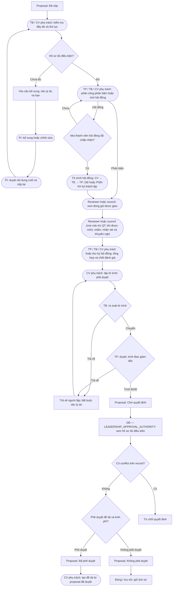

# Approval flow

Tờ trình do TB lập đi thẳng đến TP; tờ trình do TP lập vẫn qua bước TB. TB/TP
không rà soát tờ trình do chính mình lập. Chỉ GĐ phê duyệt đề tài và kinh phí;
PGĐ-KH chỉ ký thành lập hội đồng. Thư ký hội đồng tổng hợp/lập biên bản, không chấm.
