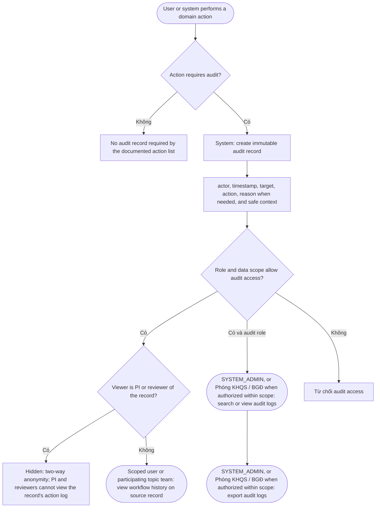

# Audit log flow

Documented audited actions include create/update/soft-delete, workflow state
changes, assignments, delegation, important file access, decisions, tờ trình
submit/forward/return/approve/sign, post-submission edits, reopen, withdrawal,
profile linking, and account/role/scope changes. The PI may still read the tờ
trình step history of their own record. Audit history is immutable; business
records, versions, relationships, decisions, and audit records are not hard-deleted.
