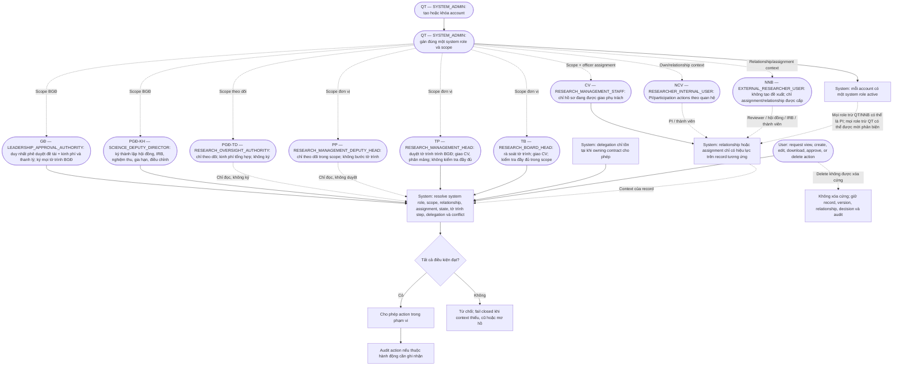

# Authorization and permission flow

`SYSTEM_ADMIN` không mặc nhiên được xem hoặc sửa dữ liệu nghiệp vụ, phản biện,
phê duyệt, hoặc mở lại hồ sơ; không có lý lịch khoa học và không được mời phản
biện. PI, thành viên hoặc reviewer của một record không dùng quyền quản lý trên
chính record đó; PI và reviewer không xem nhật ký hành động của record. Có role,
scope, relationship, assignment và state không làm mất conflict policy.
