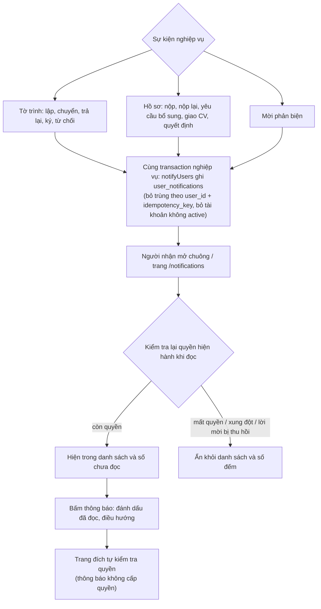

# Luồng thông báo

Story 11.1 (`_bmad-output/implementation-artifacts/spec-11-1-thong-bao-trong-ung-dung-theo-su-kien-nghiep-vu.md`):

- Thông báo ghi trong cùng transaction với thao tác nghiệp vụ; thao tác rollback thì không có thông báo. Quyết định ở D-040 (`_bmad-output/.decision-log.md`).
- Người nhận tờ trình theo bước đến: TB (`BOARD_REVIEW`), TP (`HEAD_REVIEW`), GĐ và PGĐ-KH khi loại thủ tục cho phép (`LEADERSHIP`); tác giả khi trả lại, ký, từ chối. PP và PGĐ-TD không nhận. Khi bước chuyển, thông báo "chờ xử lý" cũ của tờ trình đó được đánh dấu đã đọc.
- Khi đọc: `approval` lọc theo `canViewApproval` và xung đột; `proposal` theo `canReadProposal`; `review_assignment` theo assignment còn hiệu lực của chính người xem.
- Đánh dấu đã đọc: `POST /api/v1/notifications/:id/read` và `POST /api/v1/notifications/read-all`.
- Chưa có: email (11.2), nhắc hạn (11.3), sự kiện đề tài ngoài tờ trình (xem `deferred-work.md`).
