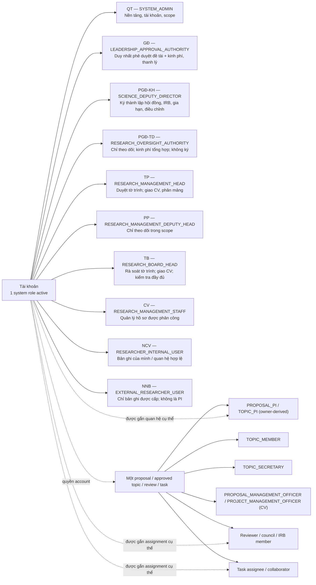
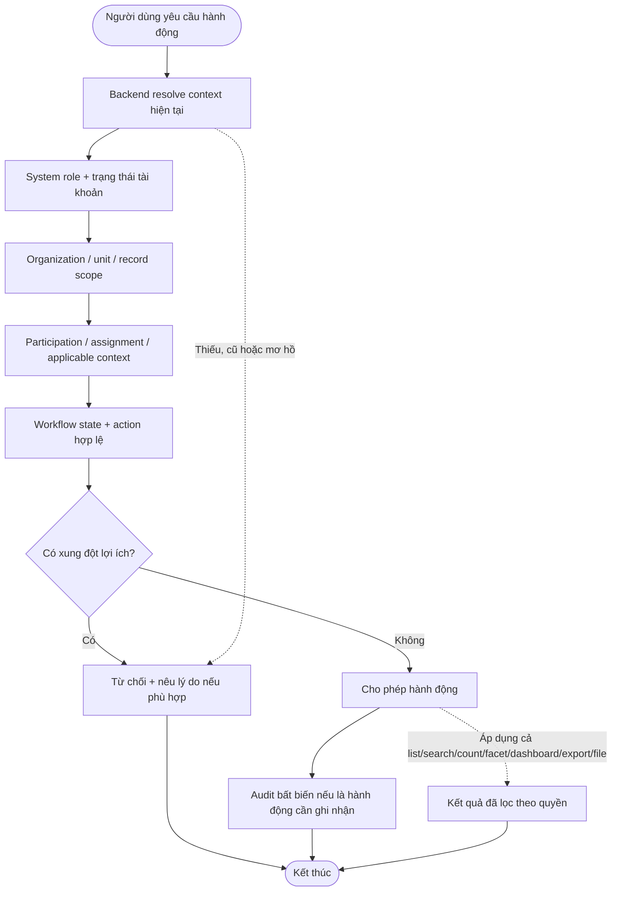
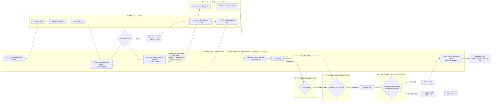
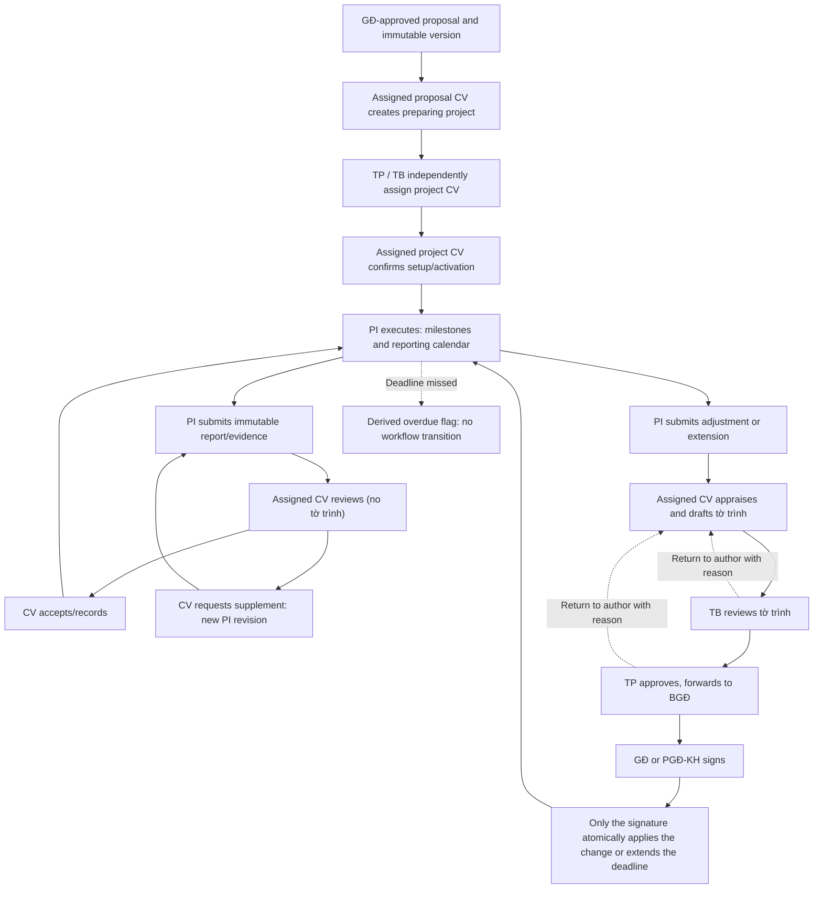
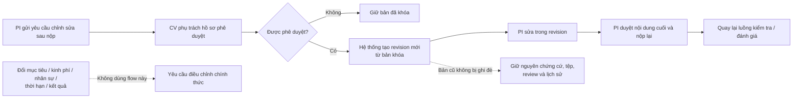
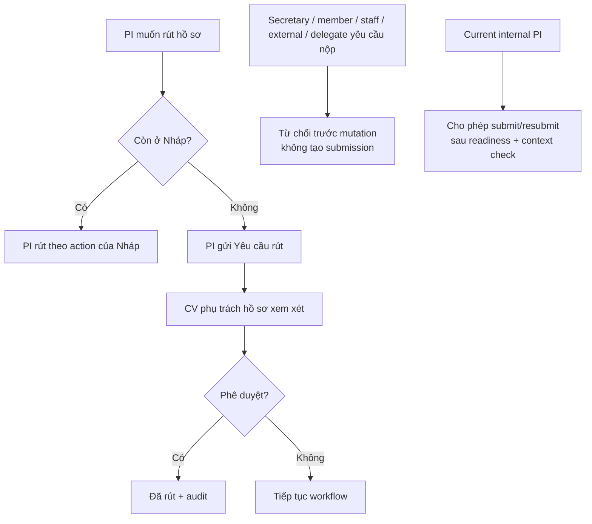
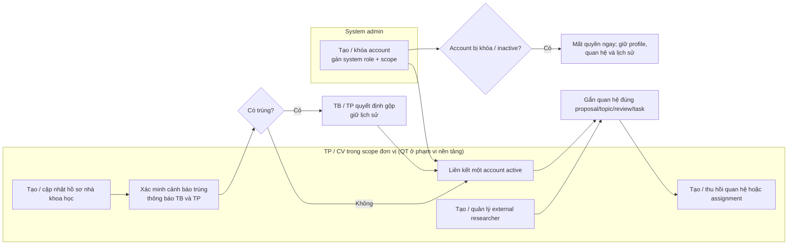
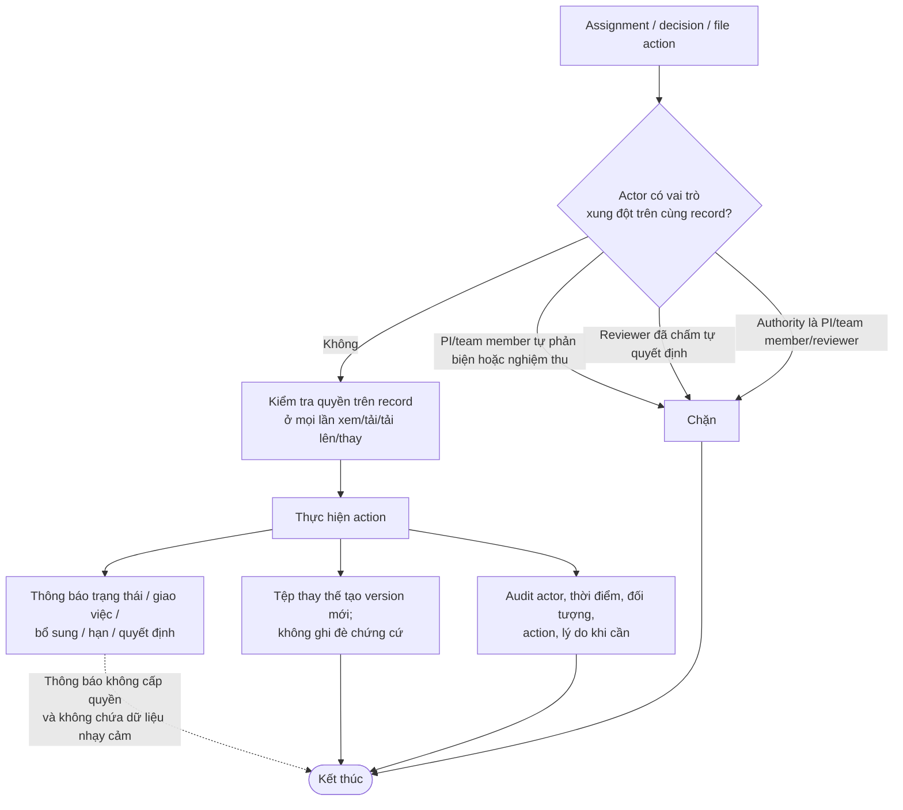
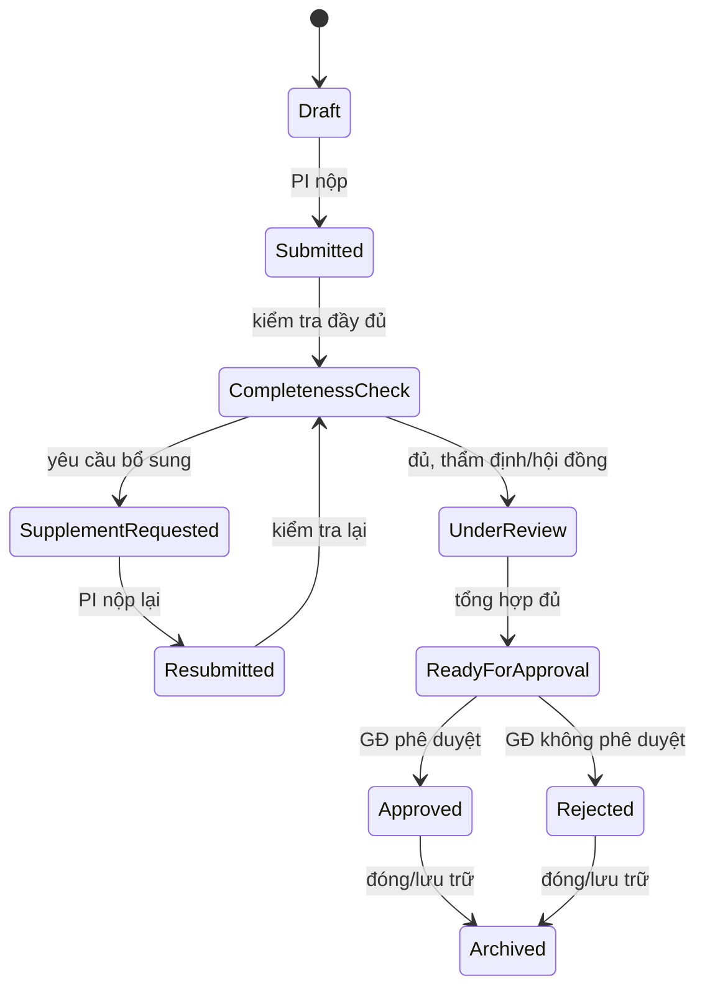
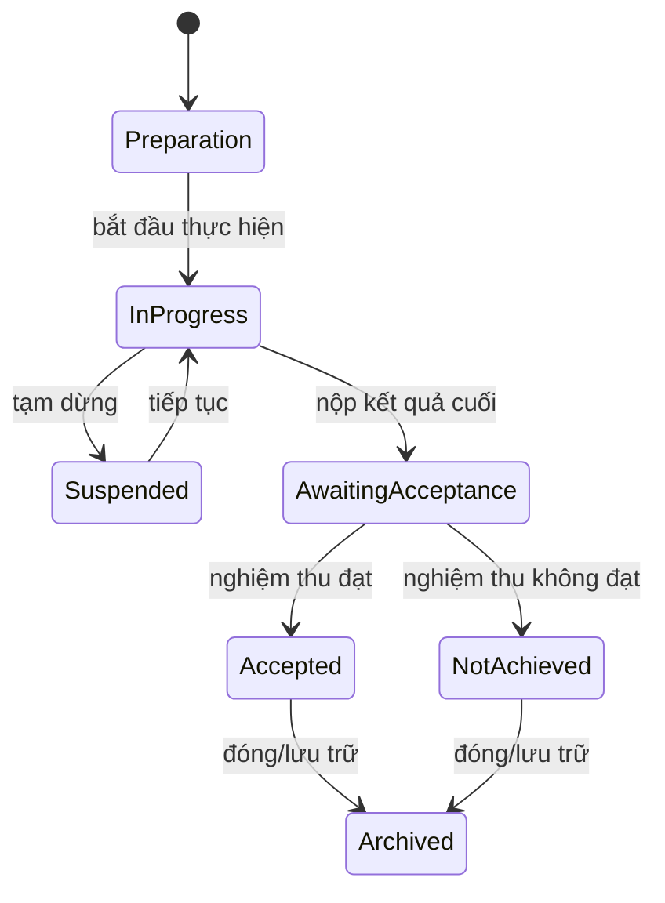

# User Flow — Vai trò và nghiệp vụ cốt lõi

> Baseline: [`authorization-core-business-baseline.md`](./authorization-core-business-baseline.md)
> Ma trận quyền: [`permission-matrix.md`](./permission-matrix.md)

Khi có mâu thuẫn, mục 7 của permission matrix (mô hình 10 vai trò) thắng; baseline
là tài liệu nền nghiệp vụ.

Tài liệu này mô tả luồng người dùng đã chốt ở mức nghiệp vụ. Mọi nhánh đều
phải đi qua kiểm tra authorization ở backend; quyền hiển thị trên UI không thay
thế kiểm tra đó.

## Diagram index

- [Overview](./diagrams/overview.md)
- [Authentication](./diagrams/authentication.md)
- [Document creation](./diagrams/document-creation.md)
- [Document viewing](./diagrams/document-viewing.md)
- [Document editing](./diagrams/document-editing.md)
- [Approval](./diagrams/approval.md)
- [Authorization](./diagrams/authorization.md)
- [Search and filtering](./diagrams/search.md)
- [Document lifecycle](./diagrams/document-lifecycle.md)
- [Version management](./diagrams/version-management.md)
- [Notifications](./diagrams/notifications.md)
- [Audit log](./diagrams/audit-log.md)

## 1. Mô hình vai trò

Mỗi tài khoản chỉ có một `system role` đang hoạt động. `PROPOSAL_PI`,
`TOPIC_PI`, `TOPIC_SECRETARY`, `TOPIC_MEMBER`, phản biện, hội đồng và người
được giao việc là quan hệ/assignment theo đúng bản ghi, không phải quyền toàn
hệ thống. Proposal PI luôn được suy ra từ `ownerId`; PI không là team row.

### Luồng giám sát và phân công quản lý

1. Khi nộp, hệ thống tự giao CV phụ trách theo mảng (cấp + tính chất); hồ sơ không khớp
   hiện “Chưa có người phụ trách”. TP/TB mở danh sách proposal/project trong scope, thấy
   officer hiện tại hoặc “Chưa phân công”; lọc/nhóm theo CV để xem workload, trạng thái và hạn.
2. TP/TB chọn, chuyển hoặc thu hồi CV phụ trách (TP phân mảng cho CV). Backend kiểm tra
   scope, account, participation/conflict và context hiện thời trước khi ghi.
3. Chuyển phân công kết thúc quan hệ cũ và tạo quan hệ mới nguyên tử, giữ history/audit;
   tối đa một `PROPOSAL_MANAGEMENT_OFFICER` / `PROJECT_MANAGEMENT_OFFICER` hiện hành.
4. CV thấy hàng chờ quản lý của mình và không thao tác hồ sơ giao cho CV khác. Hồ sơ khác
   chỉ xuất hiện qua quan hệ PI/member/secretary/reviewer/council/task hợp lệ, kèm lý do
   truy cập và action đúng quan hệ. Không hiện action quản lý chỉ vì CV đọc được hồ sơ.
5. Thu hồi/hết hiệu lực loại hồ sơ khỏi hàng chờ quản lý; backend re-authorize cả link,
   files, notification, history, count, dashboard và export. Quan hệ khác vẫn được xét.

Participant không đồng thời làm officer, reviewer, evaluation/acceptance council hoặc
quyết định cuối cùng hồ sơ; reviewer không quyết định cùng vòng, các vị trí loại trừ
trong hội đồng không được kiêm nhiệm. Kiểm tra khi tạo/thay đổi assignment/participation
và tại protected action. TP/TB không có action phê duyệt/ký của Ban giám đốc; TP duyệt
tờ trình trình BGĐ, TB rà soát tờ trình trước TP (permission matrix §7.3). PP và PGĐ-TD
chỉ theo dõi, không có bước nào trong luồng tờ trình. Đợt/profile giữ scope riêng, không mở
quyền proposal/project; project mới không tự kế thừa officer của proposal.

## 2. Cổng kiểm tra chung cho mọi hành động

List, detail, search, count/facet, dashboard, reports/export, notifications, files và workflow/business history
cũng đi qua cùng cổng này; thiếu hoặc mơ hồ context thì từ chối an toàn.

## 3. Luồng chính: đề xuất đến đề tài

Trong chi tiết proposal, section `Nộp chính thức` chỉ thuộc lane PI. Vai trò quản lý xem bảng tóm tắt chỉ đọc gồm thông tin đề tài, team, thời gian và kinh phí theo quyền xem kinh phí của vai trò; họ không nhận form sửa/nộp của PI. Mỗi phiên bản nộp hoặc nộp lại chỉ được xác nhận đầy đủ một lần; sau lần xác nhận, action giữ nguyên ngữ cảnh nhưng bị disabled và backend từ chối gửi lặp. Hạn bổ sung và các mốc hiệu lực/hạn đánh giá được nhập theo ngày Việt Nam, không nhập giờ phút.

Quy tắc cố định trong flow:

- Đợt đóng chặn hồ sơ mới nhưng không dừng hồ sơ đã nộp.
- PI hiện tại (mọi system role trừ QT/NNB) là người duy nhất được tạo, nộp và nộp
  lại proposal; không có đường delegation cho các hành động này.
- Reviewer chỉ thấy proposal/assignment được giao; gửi review xong thì review
  bị khóa; mở lại chưa có workflow được phê duyệt, không sửa ngầm.
- Ẩn danh hai chiều: PI và reviewer không xem nhật ký hành động/lịch sử của record.
- `Phiếu đánh giá của tôi` chỉ xuất hiện trong proposal có assignment đang hiệu
  lực của chính người xem; assignment ở proposal khác, role researcher/council
  hoặc system role rộng không mở rộng context.
- Kiểm tra đầy đủ/yêu cầu bổ sung: `RESEARCH_BOARD_HEAD` (TB, trong scope) hoặc `RESEARCH_MANAGEMENT_STAFF` (CV phụ trách); `RESEARCH_MANAGEMENT_HEAD` (TP) không làm. `Phân công đánh giá`, lập hội đồng/IRB, soạn/chốt tổng hợp và lập tờ trình: TP/TB trong scope hoặc CV phụ trách, có capability, state và không xung đột.
- Tờ trình: CV lập → TB rà soát → TP duyệt → Ban giám đốc ký; trả về ở bất kỳ bước nào về người lập, bắt buộc lý do. Tờ trình do TB lập đi thẳng TP; do TP lập vẫn qua TB; TB/TP không rà soát tờ trình của chính mình.
- Hội đồng đánh giá chỉ trình thành lập khi mọi thành viên đã chấp nhận; GĐ hoặc PGĐ-KH ký. Mọi role trừ QT được mời chấm; thư ký hội đồng tổng hợp/lập biên bản, không chấm.
- Chỉ GĐ (`LEADERSHIP_APPROVAL_AUTHORITY`) quyết định đề tài + kinh phí ở trạng thái
  `Chờ quyết định`/`ready_for_approval`; không sửa nội dung và không tự quyết bản ghi có xung đột.
- Phê duyệt không tự động sinh project; CV phụ trách phải tạo và xác nhận.

## 4. Golden Flow 4 — project execution

The [execution contract](contracts/project-execution.md) is normative; on role
conflicts permission-matrix §7 and §9.5 win. `PROJECT_PI` means the existing project-scoped
`TOPIC_PI`, not another system role.

CV, TB and TP never approve an adjustment/extension themselves; they appraise and
route. GĐ or PGĐ-KH signs adjustments (with or without funding change) and extensions; PP and
PGĐ-TD only monitor. No direct controlled-field edits after activation. End-date
increases require extension, never an adjustment workaround. All arrows require
current backend capability, scope, account, relationship, assignment, conflict and
version checks. Acceptance is next flow.

## 5. Luồng ngoại lệ và kiểm soát nghiệp vụ

### 5.1. Chỉnh sửa sau khi đã nộp

### 5.2. Rút hồ sơ và kiểm soát PI-only

Proposal create, submit và resubmit đều là PI-only. Không có delegation input,
delegated capability hoặc đường tái-ủy quyền cho các hành động này; mọi actor
khác bị từ chối fail closed.

### 5.3. Hồ sơ nhà khoa học, tài khoản và assignment

Với proposal reviewer/committee/IRB assignment, eligibility dựa vào account active
có lý lịch khoa học (mọi role trừ QT) và conflict trên proposal; trạng thái hoặc sự
tồn tại của profile không cấp/chặn quyền thay cho account. `TOPIC_SECRETARY` là quan hệ theo proposal/topic; nó chỉ
có thao tác được cấp và không có quyền phê duyệt cuối.

Trang hồ sơ nhà khoa học chỉ hiển thị dữ liệu và action của profile. Ba section
workflow proposal (`Phiếu đánh giá của tôi`, `Phân công đánh giá`, `Hồ sơ trình
phê duyệt`) không được dựng toàn cục trên profile; chúng chỉ nằm trong proposal
detail sau khi capability backend trả về context tương ứng.

### 5.4. Xung đột, tệp, thông báo và audit

## 6. Trạng thái cốt lõi

Các trạng thái dưới đây ánh xạ vào vòng đời đề tài 9 bước, 2 giai đoạn (D-033)
theo bảng duy nhất trong `_bmad-output/architecture.md` → "Topic Lifecycle Step
Mapping (D-033)". Yêu cầu bổ sung chỉ phát sinh ở bước 3 (kiểm tra đầy đủ).

### Đề xuất

### Đề tài

Quá hạn là cờ theo dõi/nhắc việc, không tự động từ chối, đóng hoặc chuyển
trạng thái. Không dùng cập nhật trạng thái trực tiếp để bypass các action trên.

## 7. Các giới hạn không được suy diễn từ flow

- `SYSTEM_ADMIN` không mặc nhiên xem/sửa dữ liệu nghiệp vụ, phản biện, phê
  duyệt hoặc mở lại hồ sơ.
- Capability không cấp (`ACTION_NOT_GRANTED`) thì UI bỏ cả section; conflict
  hoặc workflow-state denial của action liên quan vẫn hiển thị disabled cùng lý do.
- Có cùng đơn vị, có chức danh hiển thị hoặc có quan hệ ở bản ghi khác không
  tự cấp quyền cho bản ghi hiện tại.
- Nhà nghiên cứu không tham gia không thấy hồ sơ chỉ vì cùng đơn vị.
- `EXTERNAL_RESEARCHER_USER` không tạo/nộp/sửa đề xuất, không thấy đợt tiếp nhận;
  chỉ tham gia qua reviewer, hội đồng/IRB, thư ký hội đồng hoặc thành viên đề tài.
- `RESEARCH_MANAGEMENT_DEPUTY_HEAD` (PP) và `RESEARCH_OVERSIGHT_AUTHORITY` (PGĐ-TD)
  chỉ theo dõi; không duyệt, ký hoặc chuyển tờ trình.
- Mọi bản ghi, phiên bản, quan hệ, quyết định và audit được giữ lịch sử; không
  xóa cứng.

### Proposal reviewer / council assignment refinement

TP/TB (unit scope) or the assigned CV opens an eligible, completeness-checked
proposal → searches active user accounts → selects an eligible account and
reviewer/committee-member duty → sets optional effective range/deadline → confirms
→ backend rechecks current eligibility and context → records assignment and audit in
one transaction. Every role except QT is eligible when it has no PI/team conflict;
host-unit scope and profile linkage do not determine eligibility; a linked profile is
optional provenance, never created by assignment. An empty
candidate list explains eligibility filters. A stale/denied request shows
the server error and requires refresh before retry. Revocation requires a reason,
retains assignment/review history, and removes access immediately. The normative
eligibility and disclosure boundary is the User Account assignment contract in
`permission-matrix.md`.

## Researcher Profile completion — 2026-09-15

[Researcher Profile / Account / My Profile contract](contracts/researcher-profile-access.md) is the current
source of truth for this feature, including API/data fields, authorization,
credential delivery, migration compatibility and history retention.

- SYSTEM_ADMIN (platform) and RESEARCH_MANAGEMENT_HEAD / RESEARCH_MANAGEMENT_STAFF
  (unit scope) manage internal/external
  profiles independently of Accounts, including academic/contact information,
  position, military rank, expertise, publications and self-reported project
  history (title, role, Academy/institutional/Ministry/other level, dates, status,
  notes). Profile activation and account activation remain separate actions.
- Account provisioning creates linked `PENDING_ACTIVATION` researcher accounts:
  INTERNAL profiles provision by default with required email; EXTERNAL profiles
  provision only when the profile manager (QT/TP/CV) checks `Tạo tài khoản truy cập hệ thống`.
- Activation uses hashed single-use tokens, expires exactly after 48 hours and
  sends only a setup-password link. No temporary password is generated, emailed,
  persisted, returned to staff or placed in audit.
- Login accepts either configured username or account email. Username is optional
  at provisioning, unique when set later by the linked researcher in My Profile,
  and never inferred from email.
- My Profile uses the active Account's current link. Only own personal/scientific
  fields and own username are editable; type, status, linkage, email credential
  destination and role/scope remain administrative.
- Profile/link/account/activation/username/account-status audit is preserved with
  safe transactional change facts.

### Profile onboarding and self completion

`QT or scoped TP/CV saves profile → account provisioning decision → creates and
links PENDING_ACTIVATION Account when required/requested → system sends activation
link → researcher sets password → account becomes ACTIVE → researcher logs in with
email or username → My Profile completion`.

Accountless branch: save profile and continue directory/history management. No
account or email is required until access is requested. Existing-account branch:
select an eligible unlinked matching-role account and link without changing its
role/scope. Pending branch: show email, `Chờ kích hoạt`, expiry and allow resend
activation. Delivery failure branch: inspect pending/unknown status, confirm email
and issue a new activation token. Unlink branch: enter reason, end current link,
retain history, remove My Profile access immediately.

### Leadership and research oversight

BGĐ roles open scoped institutional records and operational counts/status/deadlines.
`LEADERSHIP_APPROVAL_AUTHORITY` (GĐ) alone approves topic + funding and liquidation,
only for packages routed through TB and TP without participation/review conflicts.
`SCIENCE_DEPUTY_DIRECTOR` (PGĐ-KH) signs council/IRB/acceptance establishment, IRB
certificates, extensions and adjustments (with or without funding change). `RESEARCH_OVERSIGHT_AUTHORITY`
(PGĐ-TD) only monitors, sees aggregate funding only and signs nothing;
`RESEARCH_MANAGEMENT_DEPUTY_HEAD` (PP) likewise only monitors within unit scope.
PI/member/reviewer work of any of these roles is evaluated independently. TP/TB assign
CVs; TP/TB or the assigned CV assign reviewers, read submitted reviews, draft/finalize
synthesis and draft the tờ trình; TB reviews and TP approves it before BGĐ.
Protected reviewer information is omitted from oversight responses. Project/dashboard/
notification/report routes without operational backends remain design requirements.
